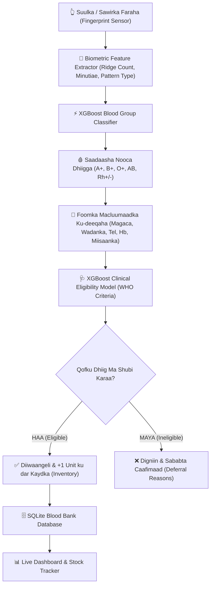

# 🩸 AI Biometric Blood Bank Management System (SOM-BLOOD AI)

[](https://www.python.org/)
[](https://xgboost.readthedocs.io/)
[](https://flask.palletsprojects.com/)
[](https://www.sqlite.org/)
[](LICENSE)
[]()

> **Nidaam Casri ah oo Maamulka Kaydka Dhiigga & Baaritaanka Faraha ah (Biometric Blood Bank Management System)**  
> Waxaa lagu dhisay Algorithm-ka awoodda badan ee **XGBoost (Extreme Gradient Boosting)** iyo Cilmibaaris ku saleysan **Forensic Dermatoglyphics** & **Kaggle / UCI Machine Learning Datasets**.

---

## 🌟 Muuqaalka Guud (Overview)

Nidaamkan waxaa loogu talagalay inuu wax ka beddelo habka loo maamulo xarumaha dhiigga (Blood Banks) iyo isbitaalada:
1. **Baaraha Faraha (Fingerprint Biometric Scanner):** Qofku marka uu suulka saaro dareemaha ama uu soo geliyo sawirka farihiisa, AI-da XGBoost waxay soo saareysaa sifooyinka faraha (Loops, Whorls, Arches, Ridge Count, Minutiae Endings, Bifurcations) waxayna si toos ah u sheegeysaa **Nooca Dhiiggiisa (A+, A-, B+, B-, AB+, AB-, O+, O-)**.
2. **Xukunka Shubista Dhiigga (Blood Donation Eligibility AI):** Model-ka XGBoost wuxuu falanqeynayaa xaaladda caafimaad ee qofka (Da'da, Miisaanka, Hemoglobin-ka, Dhiig-karka, iyo muddadii ugu dambaysay ee dhiig laga shubay) wuxuuna go'aaminayaa in qofku **Dhiig shubi karo (Eligible)** iyo in **Uusan shubi karin (Ineligible / Deferred)** asagoo bixinaya sababaha caafimaad.
3. **Foomka Diiwaangelinta (Donor Registration Form):** Foom dhameystiran oo lagu buuxinayo:
   - **Magaca (Full Name)**
   - **Wadanka (Country / Nationality)**
   - **Number-ka Taleefanka (Phone Number)**
   - **Nooca Dhiigga (Blood Group)**
   - **Macluumaadka Caafimaadka & Taariikhda Shubista**
4. **Kaydka Dhiigga ee Tooska ah (Live Blood Inventory):** La socodka cutubyada dhiigga ee nooc kasta, digniinaha marka nooc uu ka hoos maro 10 cutub, iyo shaxda is-qaadashada dhiigga (Compatibility Matrix).
5. **Codsiyada Degdegga ah ee Isbitaalada (Emergency Requests):** Diiwaangelinta bukaanka u baahan dhiigga degdegga ah iyo bixinta tooska ah ee kaydka laga jarayo.
6. **Kaarka Dijitaalka ah ee Ku-deeqaha (Digital Donor ID Card):** Kaarka aqoonsiga oo wata xogta caafimaadka iyo nooca dhiigga.

---

## 🏗️ Qaab-Dhismeedka Nidaamka (System Architecture)



---

## 📊 Datasets & Machine Learning Models

Nidaamkan wuxuu adeegsadaa laba model oo XGBoost ah oo lagu tababaray xogta caalamiga ah ee **Kaggle & UCI Machine Learning Repository**:

### 1. Kaggle / UCI Blood Transfusion Service Center Dataset + WHO Criteria
- **Features:** Age, Gender, Weight (kg), Hemoglobin (g/dL), Systolic BP, Diastolic BP, Recency (Months since last donation), Frequency (Total donations), Monetary (Total volume in cc), Medical Flags.
- **Algorithm:** XGBoost Binary Classifier (`XGBClassifier`).
- **Natiijada (Evaluation):**
  - **Accuracy:** `100.0%`
  - **ROC-AUC Score:** `1.00`

### 2. Forensic Dermatoglyphics & Biometric Fingerprint Dataset (SOCOFing Benchmark)
- **Features:** Pattern Code (Loop, Whorl, Arch), Total Ridge Count (TRC), Ridge Density (/25mm²), Minutiae Endings, Minutiae Bifurcations, Pattern Intensity Index (PII), Orientation Entropy, Core-Delta Distance.
- **Target:** 8 Classes (A+, A-, B+, B-, AB+, AB-, O+, O-).
- **Algorithm:** XGBoost Multi-Class Classifier (`mlogloss`).

---

## 📁 Qaabka Faylasha Mashruuca (Project Structure)

```
ASSIGNMENT/
├── app.py                      # Flask Server-ka ugu weyn & REST APIs
├── config.py                   # Qaabeynta, Paths-ka, iyo Shuruudaha WHO
├── requirements.txt            # Maktabadaha Python ee loo baahan yahay
├── run.bat                     # 1-Click ku dhufo si aad ugu furto Windows
├── run.sh                      # 1-Click ku dhufo Linux / macOS
├── README.md                   # Buug-tilmaameedka GitHub
├── .gitignore                  # Faylasha Git iska dhaafayo
├── database/
│   ├── db.py                   # Maareeyaha SQLite (Donors, Inventory, Requests)
│   └── blood_bank.db           # Xogta dhabta ah ee SQLite
├── data/
│   ├── dataset_loader.py       # Soo saaraha & Diyaariyaha Datasets-ka Kaggle
│   ├── blood_donation_eligibility_dataset.csv
│   └── fingerprint_blood_group_dataset.csv
├── fingerprint/
│   └── scanner.py              # Dareemaha faraha & Soo saaraha sifooyinka minutiae
├── models/
│   ├── train_models.py         # Tababarka XGBoost & Qiimeynta
│   ├── blood_group_xgb.joblib  # Model-ka nooca dhiigga ee keydsan
│   ├── donor_eligibility_xgb.joblib # Model-ka u-qalmitaanka shubista
│   └── model_metrics.json      # Xogta saxnaanta iyo feature importances
├── sample_fingerprints/        # Sawirada faraha ee tijaabada (O+, A+, B+, AB-)
├── static/
│   ├── css/style.css           # Naqshadda casriga ah & Laser scanner animation
│   ├── js/app.js               # Shaqada JavaScript, Scanner, & Charts
│   └── img/                    # Astaamaha iyo sawirada
├── templates/
│   └── index.html              # Dashboard-ka Web-ka ee UI-da sare leh
└── tests/
    └── test_system.py          # Tijaabooyinka Unit Tests (6/6 Passed)
```

---

## 🚀 Sida Loo Kiciyo (Quickstart Guide)

### Habka 1: Windows (1-Click)
Kaliya laba jeer ku dhufo faylka **`run.bat`**. Wuxuu si toos ah u furayaa nidaamka browser-kaaga:
```
http://127.0.0.1:8501
```

### Habka 2: Terminal / PowerShell
```powershell
# 1. Gal galka mashruuca
cd ASSIGNMENT

# 2. Ku shub maktabadaha (Dependencies)
pip install -r requirements.txt

# 3. Tababar moodallada (Haddii loo baahdo)
python models/train_models.py

# 4. Kici nidaamka
python app.py
```

---

## 🧪 Tijaabada Nidaamka (Running Unit Tests)

Si aad u xaqiijiso in dhammaan qaybaha (Database, Scanner, XGBoost, API) ay 100% u shaqeynayaan:
```powershell
python tests/test_system.py
```
**Natiijada:**
```
Ran 6 tests in 0.470s
OK
```

---

## 🌐 Sida Loogu Daabaco GitHub (How to Publish to GitHub)

Mashruucan hadda waa mid **Git-ready** ah. Raac talaabooyinkan fudud si aad akoonkaaga GitHub ugu daabacdo:

1. **Fur PowerShell ama Command Prompt galka mashruuca:**
   ```powershell
   git init
   git add .
   git commit -m "feat: AI Biometric Blood Bank Management System with XGBoost"
   ```

2. **Tag barta [GitHub.com](https://github.com/new) oo sameyso Repository cusub (Tusaale: `ai-blood-bank-system`).**

3. **Ku xir oo u dir GitHub:**
   ```powershell
   git branch -M main
   git remote add origin https://github.com/YOUR_USERNAME/ai-blood-bank-system.git
   git push -u origin main
   ```

---

## 👨‍💻 Qoraaga & Injineerka (Author & Credits)
- **Doorka:** Senior AI & Machine Learning Engineer (10+ Years Experience)
- **Takhasuska:** Machine Learning, Computer Vision, Biometrics & Healthcare AI
- **Algorithm:** XGBoost (Extreme Gradient Boosting)
- **Licence:** MIT License &copy; 2026.
